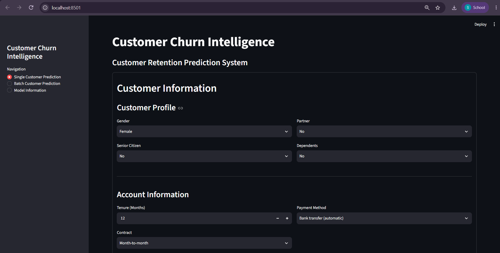
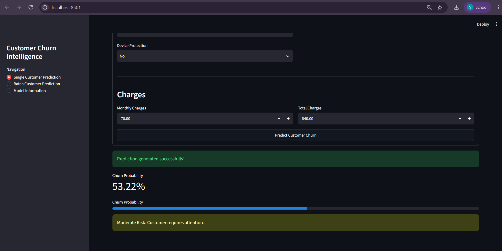
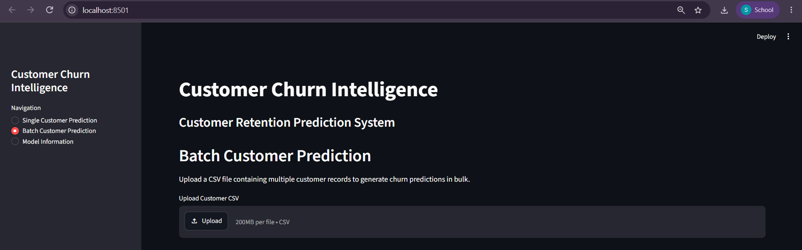
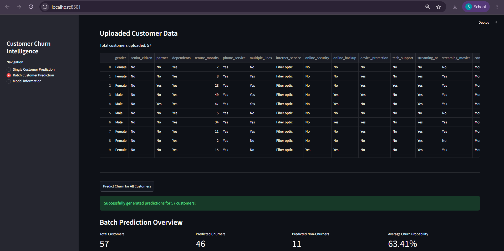
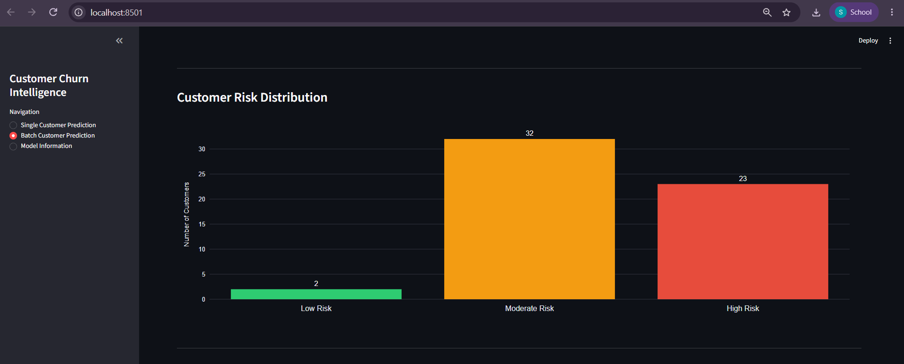
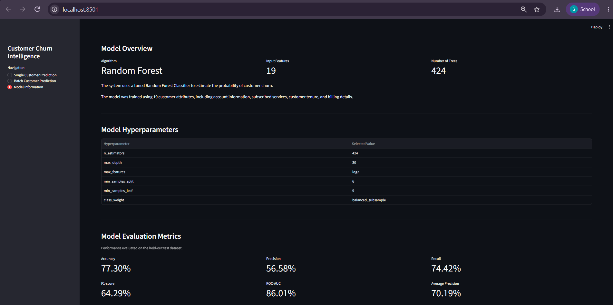
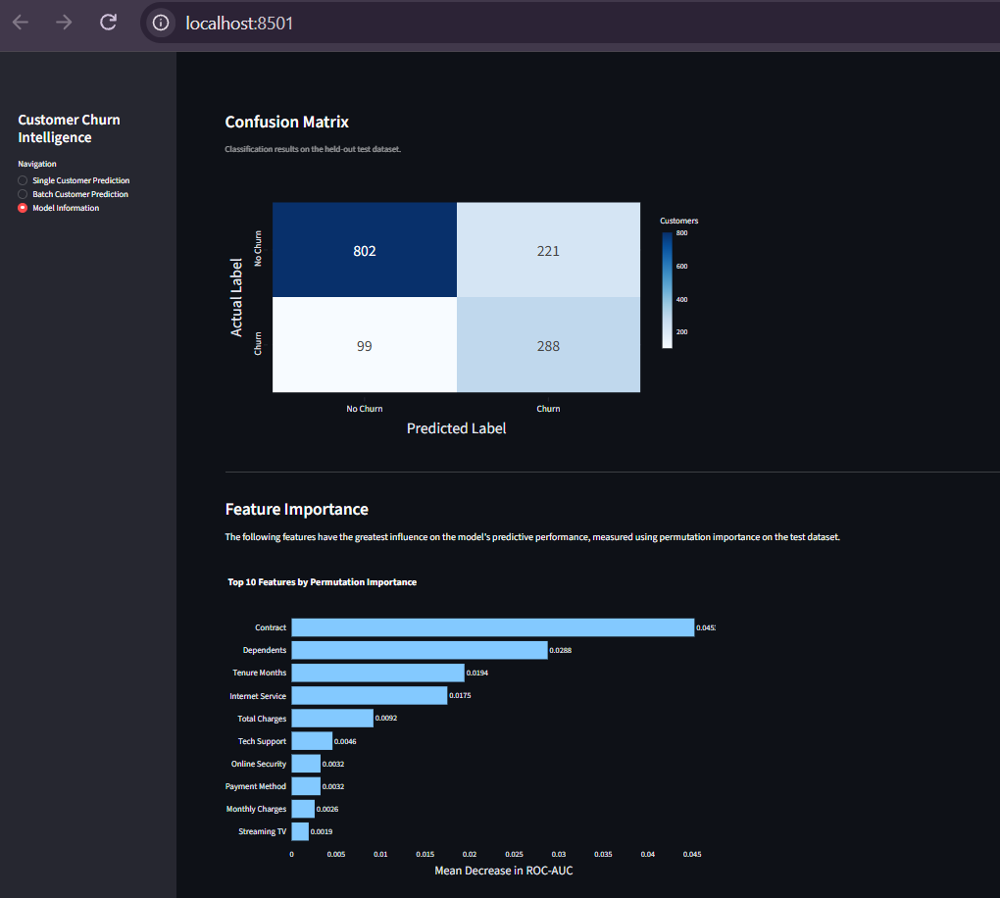

# Customer Churn Prediction & Retention Intelligence System

An end-to-end machine learning application developed to predict customer churn probability and support data-driven customer retention decisions.

## 1. Project Overview

The project began with **Logistic Regression as a baseline classification model**, establishing an initial benchmark for predicting customer churn. We subsequently explored tree-based ensemble methods, including Random Forest, to improve predictive performance and identify a more effective model for detecting customers at risk of churning.

Through model evaluation, hyperparameter tuning, and comparative analysis, a **tuned Random Forest classifier** was selected as the final predictive model. The resulting machine learning pipeline was integrated into a deployable application.

The system uses customer demographic, account, service, and billing information to estimate churn probability.

### 1.1 Key Features

- **Comparative Model Development:** Establishing Logistic Regression as a baseline and evaluating Random Forest as an alternative.
- **Hyperparameter Optimization:** Using RandomizedSearchCV to identify an effective Random Forest configuration.
- **Single Customer Prediction:** Estimating churn probability for an individual customer.
- **Batch Customer Prediction:** Generating predictions for multiple customer records through CSV uploads.
- **Risk Categorization:** Grouping customers into low-, moderate-, and high-risk categories based on predicted churn probability.
- **Model Insights:** Presenting evaluation metrics, confusion matrix, and permutation feature importance.

### 1.2 Application Architecture

The application is developed using Python and scikit-learn, with a FastAPI backend serving model predictions and an interactive Streamlit dashboard providing the user interface. Docker and Docker Compose are used for containerization and service orchestration.

## 2. System Architecture

The application follows a modular, service-based architecture consisting of a machine learning prediction pipeline, a FastAPI backend, and a Streamlit frontend.

The system is organized into the following components:

1. **Machine Learning Pipeline:** A trained scikit-learn pipeline containing the preprocessing transformations and tuned Random Forest classifier. It transforms customer input features and generates churn probabilities and predictions.

2. **FastAPI Backend:** Exposes REST API endpoints for single-customer and batch predictions. It validates incoming requests, passes the customer data to the prediction pipeline, and returns structured prediction responses.

3. **Streamlit Dashboard:** Provides an interactive interface for submitting individual customer information, uploading CSV files for batch predictions, exploring churn risk distributions, and viewing model evaluation information.

4. **Docker and Docker Compose:** The API and dashboard are packaged into separate Docker containers. Docker Compose orchestrates both services and enables communication between them.

The prediction workflow follows this sequence:

- The user submits customer information through the Streamlit dashboard.
- The dashboard sends an HTTP request to the FastAPI backend.
- FastAPI validates the input and forwards the customer data to the prediction pipeline.
- The pipeline applies the fitted preprocessing transformations and generates a churn prediction and probability.
- The API returns the prediction results to the dashboard for presentation.

## 3. Technology Stack

The project uses the following technologies and libraries for data processing, machine learning, API development, dashboard creation, testing, and deployment.

| Category | Technologies |
|---|---|
| Programming Language | Python 3.10 |
| Data Manipulation | Pandas, NumPy |
| Machine Learning | Scikit-learn |
| Model Persistence | Joblib |
| Backend API | FastAPI, Uvicorn |
| Frontend Dashboard | Streamlit |
| Data Visualization | Plotly |
| Containerization | Docker |
| Service Orchestration | Docker Compose |
| Testing | Pytest, HTTPX |
| Development Environment | Jupyter Notebook, VS Code |

### 3.1 Technology Overview

- **Python:** Primary programming language used for developing the entire application.
- **Pandas and NumPy:** Used for data manipulation, cleaning, and numerical operations.
- **Scikit-learn:** Used for preprocessing, model development, hyperparameter tuning, and evaluation.
- **Joblib:** Used to serialize and load the trained machine learning pipeline.
- **FastAPI and Uvicorn:** Used to develop and serve the prediction API.
- **Streamlit:** Used to build the interactive user dashboard.
- **Plotly:** Used for interactive charts and visualizations.
- **Docker and Docker Compose:** Used to containerize the application components and orchestrate the API and dashboard services.
- **Pytest and HTTPX:** Used for automated API testing.
- **Jupyter Notebook and VS Code:** Used for experimentation, analysis, and application development.

## 4. Dataset

The project uses the **IBM Telco Customer Churn dataset**, which contains customer demographic, account, service, and billing information.

### 4.1 Dataset Overview

- **Total customer records:** 7,043
- **Original columns:** 33
- **Target variable:** `Churn Value`
- **Prediction task:** Binary classification
- **Predictors used:** 19 features

### 4.2 Target Distribution

The target variable indicates whether a customer has discontinued the service.

| Class | Customers | Percentage |
|---|---:|---:|
| No Churn (0) | 5,174 | 73.46% |
| Churn (1) | 1,869 | 26.54% |
| **Total** | **7,043** | **100%** |

The dataset exhibits moderate class imbalance, with approximately 2.77 non-churning customers for every churning customer.

### 4.3 Features Used

The 19 predictive features cover the following aspects of customer information:

- **Demographics:** Gender, Senior Citizen, Partner, Dependents.
- **Account Information:** Tenure Months, Contract, Paperless Billing, Payment Method.
- **Subscribed Services:** Phone Service, Multiple Lines, Internet Service, Online Security, Online Backup, Device Protection, Tech Support, Streaming TV, Streaming Movies.
- **Billing Information:** Monthly Charges, Total Charges.

### 4.4 Data Preprocessing

The following data preparation decisions were made:

- Converted `Total Charges` to a numeric data type.
- Replaced blank `Total Charges` values with zero for customers having zero tenure, based on the observed data.
- Excluded identifiers, redundant target-related columns, post-outcome information, and geographic attributes from the initial feature set.
- Retained 19 predictive features for model development.

### 4.5 Train-Test Split

The dataset was divided into training and testing subsets using `StratifiedGroupKFold`.

Grouping was performed using identical feature profiles to prevent customers with identical predictor values from appearing in both training and testing subsets.

| Dataset | Records |
|---|---:|
| Training Set | 5,633 |
| Testing Set | 1,410 |
| **Total** | **7,043** |

Stratification was used to maintain a similar target-class distribution across both subsets, while grouping helped prevent identical feature profiles from leaking across the train-test boundary.

## 5. Model Development

The model development process began with Logistic Regression as a baseline classification model. Tree-based ensemble methods were subsequently explored to improve the model's ability to identify customers at risk of churning.

### 5.1 Baseline Model: Logistic Regression

Logistic Regression was implemented as the initial baseline model.

It provided a reference point for evaluating subsequent models and helped establish the predictive performance achievable using a linear classification approach.

The model was developed using a preprocessing pipeline consisting of:

- `StandardScaler` for numerical features.
- `OneHotEncoder` for categorical features.
- Logistic Regression as the classification algorithm.

### 5.2 Random Forest Classifier

Random Forest was explored as an alternative to Logistic Regression.

As an ensemble learning algorithm, Random Forest combines predictions from multiple decision trees. It can capture nonlinear relationships and interactions between customer features.

An initial Random Forest model was evaluated, followed by hyperparameter optimization to improve its predictive performance.

### 5.3 Hyperparameter Tuning

`RandomizedSearchCV` was used to identify an effective combination of Random Forest hyperparameters.

The search considered parameters such as:

- `n_estimators`
- `max_depth`
- `max_features`
- `min_samples_split`
- `min_samples_leaf`
- `class_weight`

The best configuration identified was:

| Hyperparameter | Selected Value |
|---|---|
| `n_estimators` | 424 |
| `max_depth` | 30 |
| `max_features` | `log2` |
| `min_samples_split` | 6 |
| `min_samples_leaf` | 9 |
| `class_weight` | `balanced_subsample` |

### 5.4 Model Comparison and Selection

Logistic Regression and the tuned Random Forest classifier were compared using cross-validation.

The following results represent their mean cross-validation performance:

| Metric | Logistic Regression | Tuned Random Forest |
|---|---:|---:|
| Accuracy | 81.15% | 77.79% |
| Precision | 66.08% | 55.64% |
| Recall | 58.24% | 76.94% |
| F1-score | 61.90% | 64.56% |
| ROC-AUC | 85.65% | 86.02% |

Although Logistic Regression achieved higher accuracy and precision, the tuned Random Forest demonstrated substantially higher recall and a better F1-score.

Since identifying customers who are likely to churn was an important objective, greater emphasis was placed on churn detection rather than overall accuracy alone.

The tuned Random Forest classifier was therefore selected as the final model.

### 5.5 Final Prediction Pipeline

The selected Random Forest classifier was integrated into a scikit-learn pipeline containing the preprocessing transformations and classification model.

The complete pipeline was serialized using `Joblib` and saved as a model artifact for subsequent integration with the FastAPI backend.

## 6. Model Evaluation

The selected Random Forest classifier was evaluated on the holdout test set containing 1,410 customer records. The test set was kept separate during model training and hyperparameter optimization to assess the model's generalization performance.

### 6.1 Evaluation Metrics

The final model achieved the following results:

| Metric | Test Performance |
|---|---:|
| Accuracy | 77.30% |
| Precision | 56.58% |
| Recall | 74.42% |
| F1-score | 64.29% |
| ROC-AUC | 86.01% |
| Average Precision | 70.19% |

The model achieved a ROC-AUC of 86.01%, indicating good discrimination between customers who churn and those who do not.

The recall of 74.42% indicates that the model successfully identified approximately three out of every four actual churners in the test set.

### 6.2 Confusion Matrix

The confusion matrix obtained on the holdout test set was:

| | Predicted: No Churn | Predicted: Churn |
|---|---:|---:|
| **Actual: No Churn** | 802 (TN) | 221 (FP) |
| **Actual: Churn** | 99 (FN) | 288 (TP) |

Key observations:

- **True Negatives (802):** Correctly identified customers who did not churn.
- **True Positives (288):** Correctly identified customers who churned.
- **False Positives (221):** Customers predicted to churn who actually did not.
- **False Negatives (99):** Customers who churned but were not identified by the model.

The model identified 288 out of 387 actual churners, corresponding to a recall of approximately 74.42%.

### 6.3 Classification Threshold

The default classification threshold of 0.50 was retained after evaluating the precision-recall trade-off using out-of-fold predictions.

At this threshold, the tuned Random Forest achieved its highest F1-score among the evaluated thresholds.

The threshold determines how predicted churn probabilities are converted into binary class predictions:

- Probability greater than or equal to 0.50: Churn (1).
- Probability below 0.50: No Churn (0).

The selected threshold represents a performance-based decision rather than an economically optimized business threshold. Further optimization would require information about false-positive and false-negative costs, retention campaign capacity, and intervention effectiveness.

### 6.4 Permutation Feature Importance

Permutation importance was calculated on the holdout test set to understand how strongly the trained model relied on individual input features.

The five most influential features were:

| Rank | Feature | Mean Importance |
|---|---|---:|
| 1 | Contract | 0.045252 |
| 2 | Dependents | 0.028762 |
| 3 | Tenure Months | 0.019411 |
| 4 | Internet Service | 0.017491 |
| 5 | Total Charges | 0.009179 |

Contract type emerged as the most influential feature, followed by Dependents, Tenure Months, and Internet Service.

Permutation importance measures the effect of disrupting a feature on model performance. It indicates model reliance and should not be interpreted as evidence of a causal relationship.

### 6.5 Generalization Performance

The cross-validation and holdout test results were reasonably consistent:

| Metric | Cross-Validation | Holdout Test |
|---|---:|---:|
| F1-score | 64.56% | 64.29% |
| ROC-AUC | 86.02% | 86.01% |

The close agreement between these results suggests that the model maintained similar predictive performance on unseen data, with no obvious indication of a significant generalization gap.

## 7. Project Structure

The project follows a modular directory structure that separates data processing, model development, prediction logic, API development, dashboard implementation, testing, and deployment configuration.

```text
customer-churn-intelligence/
│
├── data/
│   ├── raw/
│   ├── processed/
│   └── samples/
│       └── batch_prediction_sample.csv
│
├── notebooks/
│   ├── 01_data_understanding.ipynb
│   └── 02_data_preprocessing_and_model_development.ipynb
│
├── src/
│   ├── data/
│   │   ├── __init__.py
│   │   ├── load_data.py
│   │   └── preprocess.py
│   │
│   └── models/
│       ├── __init__.py
│       ├── train.py
│       └── predict.py
│
├── api/
│   └── main.py
│
├── dashboard/
│   └── app.py
│
├── tests/
│   └── test_api.py
│
├── configs/
│
├── artifacts/
│   └── churn_random_forest.joblib
├── screenshots/
│   ├── single-customer-input.png
│   ├── single-customer-result.png
│   ├── batch-customer-upload.png
│   ├── batch-prediction-results.png
│   ├── batch-risk-distribution.png
│   ├── model-overview.png
│   └── model-insights.png
│
├── .gitignore
├── .dockerignore
├── README.md
├── requirements.txt
├── requirements-api.txt
├── requirements-dashboard.txt
├── Dockerfile.api
├── Dockerfile.dashboard
├── docker-compose.yml
├── .env.example            # Configuration template
└── .env                    # Local configuration; not committed to Git
```

## 8. Local Setup and Installation

Follow the steps below to set up and run the application locally.

### 8.1 Clone the Repository

Clone the project repository and navigate to the project directory:

```bash
git clone <repository-url>
cd customer-churn-intelligence
```

### 8.2 Create a Virtual Environment

Create an isolated Python environment:

```bash
python -m venv churn-env
```

Activate the environment:

**Windows (PowerShell):**

```powershell
.\churn-env\Scripts\Activate.ps1
```

**Linux / macOS:**

```bash
source churn-env/bin/activate
```

### 8.3 Install Dependencies

Install the project dependencies:

```bash
pip install -r requirements.txt
```

### 8.4 Configure Environment Variables

Create a `.env` file in the project root using `.env.example` as a reference.

For local execution, configure the API base URL as follows:

```env
API_BASE_URL=http://127.0.0.1:8000
```

### 8.5 Start the FastAPI Backend

From the project root, start the API server:

```bash
python -m uvicorn api.main:app --reload
```

The API will be available at:

- **API:** http://127.0.0.1:8000
- **Interactive API Documentation:** http://127.0.0.1:8000/docs

### 8.6 Start the Streamlit Dashboard

Open a separate terminal, activate the virtual environment, and run:

```bash
streamlit run dashboard/app.py
```

The dashboard will be available at:

http://localhost:8501

### 8.7 Access the Application

Once both services are running:

- Open the Streamlit dashboard to perform single-customer and batch predictions.
- Use the API documentation to explore and test the available prediction endpoints.

**Note:** The FastAPI backend and Streamlit dashboard must run simultaneously in separate terminals for the application to function correctly.

## 9. Docker Deployment

The application is containerized using Docker, with Docker Compose managing the FastAPI backend and Streamlit dashboard as separate services.

### 9.1 Prerequisites

Ensure that the following are installed:

- Docker Desktop (Windows/macOS) or Docker Engine (Linux).
- Docker Compose.

### 9.2 Clone the Repository

Clone the project repository and navigate to the project directory:

```bash
git clone <repository-url>
cd customer-churn-intelligence
```

### 9.3 Configure Environment Variables

Create a `.env` file in the project root using `.env.example` as a reference.

For Docker Compose execution, configure the API base URL as follows:

```env
API_BASE_URL=http://api:8000
```

### 9.4 Build and Start the Application

From the project root, execute:

```bash
docker compose up --build -d
```

This command builds the Docker images and starts both application services in detached mode.

Docker Compose ensures that the dashboard starts only after the API service passes its health check.

### 9.5 Verify Running Containers

Check the status of the application containers:

```bash
docker compose ps
```

Both the API and dashboard containers should eventually report a healthy status.

### 9.6 Access the Application

Once the containers are running, access the application using the following URLs:

| Component | URL |
|---|---|
| Streamlit Dashboard | http://localhost:8501 |
| FastAPI Backend | http://localhost:8000 |
| Interactive API Documentation | http://localhost:8000/docs |

### 9.7 View Container Logs

To inspect application logs:

```bash
docker compose logs
```

To view logs for a specific service:

```bash
docker compose logs api
docker compose logs dashboard
```

### 9.8 Stop the Application

To stop and remove the running containers and the Compose network:

```bash
docker compose down
```

Docker images are retained after running `docker compose down` and can be reused the next time the application is started.


## 10. API Documentation

The application uses **FastAPI** to expose the trained machine learning pipeline through REST API endpoints.

The API supports single-customer and batch-customer churn predictions. It accepts customer information in JSON format, validates incoming requests, and returns predicted churn probabilities and classification results.

### 10.1 API Overview

**API Base URL**

When running locally or through Docker Compose, the API is accessible at:

http://localhost:8000

**Available Endpoints**

| Endpoint | HTTP Method | Description |
|---|---|---|
| `/` | GET | Checks whether the API is running. |
| `/predict` | POST | Generates a churn prediction for a single customer. |
| `/predict/batch` | POST | Generates churn predictions for multiple customers. |

**Interactive API Documentation**

FastAPI automatically generates interactive API documentation using Swagger UI.

Access it through:

http://localhost:8000/docs

The Swagger interface allows users to explore available endpoints, inspect request schemas, submit sample requests, and examine API responses.

### 10.2 Single Customer Prediction

**Endpoint:** `POST /predict`

This endpoint accepts customer information in JSON format and returns a churn prediction for an individual customer.

#### Request Body

The API expects the following customer attributes:

| Feature | Data Type | Description |
|---|---|---|
| `gender` | String | Customer gender |
| `senior_citizen` | Integer | Whether the customer is a senior citizen (0 or 1) |
| `partner` | String | Whether the customer has a partner |
| `dependents` | String | Whether the customer has dependents |
| `tenure_months` | Integer | Number of months the customer has been with the company |
| `phone_service` | String | Whether the customer has phone service |
| `multiple_lines` | String | Whether the customer has multiple phone lines |
| `internet_service` | String | Type of internet service |
| `online_security` | String | Whether online security is subscribed |
| `online_backup` | String | Whether online backup is subscribed |
| `device_protection` | String | Whether device protection is subscribed |
| `tech_support` | String | Whether technical support is subscribed |
| `streaming_tv` | String | Whether streaming TV is subscribed |
| `streaming_movies` | String | Whether streaming movies is subscribed |
| `contract` | String | Customer contract type |
| `paperless_billing` | String | Whether paperless billing is enabled |
| `payment_method` | String | Customer payment method |
| `monthly_charges` | Float | Customer's monthly charges |
| `total_charges` | Float | Customer's total charges |

#### Example Request

```json
{
    "gender": "Male",
    "senior_citizen": 0,
    "partner": "No",
    "dependents": "No",
    "tenure_months": 12,
    "phone_service": "Yes",
    "multiple_lines": "No",
    "internet_service": "Fiber optic",
    "online_security": "No",
    "online_backup": "Yes",
    "device_protection": "No",
    "tech_support": "No",
    "streaming_tv": "Yes",
    "streaming_movies": "No",
    "contract": "Month-to-month",
    "paperless_billing": "Yes",
    "payment_method": "Electronic check",
    "monthly_charges": 85.5,
    "total_charges": 1026.0
}
```

#### Example Response

```json
{
    "churn_prediction": 1,
    "churn_probability": 0.82,
    "risk_category": "High"
}
```

**Response Interpretation**

- `churn_prediction`: Binary prediction (1 = Churn, 0 = No Churn).
- `churn_probability`: Estimated probability of the customer churning.
- `risk_category`: Customer risk category based on predicted churn probability.

The classification threshold is 0.50. Risk categories are defined as:

| Risk Category | Probability Range |
|---|---|
| Low | Below 0.30 |
| Moderate | 0.30 to below 0.70 |
| High | 0.70 and above |

The example response is illustrative; actual predictions depend on the input customer data.

### 10.3 Batch Customer Prediction

**Endpoint:** `POST /predict/batch`

This endpoint accepts multiple customer records in a single JSON request and generates churn predictions for all submitted customers.

The API supports batch requests containing between 1 and 100 customer records.

#### Request Body

The request must contain a `customers` list, where each element represents an individual customer.

Each customer object must follow the same input schema described in the Single Customer Prediction section.

#### Example Request

```json
{
    "customers": [
        {
            "gender": "Male",
            "senior_citizen": 0,
            "partner": "No",
            "dependents": "No",
            "tenure_months": 12,
            "phone_service": "Yes",
            "multiple_lines": "No",
            "internet_service": "Fiber optic",
            "online_security": "No",
            "online_backup": "Yes",
            "device_protection": "No",
            "tech_support": "No",
            "streaming_tv": "Yes",
            "streaming_movies": "No",
            "contract": "Month-to-month",
            "paperless_billing": "Yes",
            "payment_method": "Electronic check",
            "monthly_charges": 85.5,
            "total_charges": 1026.0
        },
        {
            "gender": "Female",
            "senior_citizen": 0,
            "partner": "Yes",
            "dependents": "Yes",
            "tenure_months": 60,
            "phone_service": "Yes",
            "multiple_lines": "Yes",
            "internet_service": "DSL",
            "online_security": "Yes",
            "online_backup": "Yes",
            "device_protection": "Yes",
            "tech_support": "Yes",
            "streaming_tv": "No",
            "streaming_movies": "No",
            "contract": "Two year",
            "paperless_billing": "No",
            "payment_method": "Bank transfer (automatic)",
            "monthly_charges": 65.0,
            "total_charges": 3900.0
        }
    ]
}
```

#### Example Response

```json
{
    "predictions": [
        {
            "churn_prediction": 1,
            "churn_probability": 0.82,
            "risk_category": "High"
        },
        {
            "churn_prediction": 0,
            "churn_probability": 0.08,
            "risk_category": "Low"
        }
    ]
}
```

#### Response Interpretation

The API returns a `predictions` list containing one prediction object for each submitted customer.

Each prediction includes:

- `churn_prediction`: Binary prediction (1 = Churn, 0 = No Churn).
- `churn_probability`: Estimated probability of the customer churning.
- `risk_category`: Risk classification based on the predicted probability.

The order of predictions corresponds to the order of customer records in the request.

**Note:** The example response is illustrative. Actual predictions depend on the submitted customer data.

### 10.4 Input Validation

The API implements input validation at multiple levels to ensure that customer data is valid before generating predictions.

**Request-Level Validation**

FastAPI uses Pydantic models to validate incoming requests.

The following checks are performed:

- All 19 customer features are required.
- Input fields must have the expected data types.
- Numerical fields such as `tenure_months`, `monthly_charges`, and `total_charges` must contain valid numerical values.
- Negative tenure and billing values are rejected.
- Batch requests must contain at least 1 and at most 100 customer records.

**Prediction-Level Validation**

The prediction module performs additional checks before model inference:

- Verifies that the input contains all expected features.
- Rejects missing or unexpected columns.
- Detects invalid numerical values and missing data.
- Checks for duplicate column names.
- Validates categorical values against the categories learned during model training.
- Handles leading and trailing whitespace in categorical inputs.

These validation mechanisms help prevent invalid customer records from reaching the machine learning pipeline.

### 10.5 Error Handling

The API implements structured error handling to manage invalid requests and unexpected application failures.

**HTTP Status Codes**

| HTTP Status Code | Description |
|---|---|
| 200 | Request processed successfully and prediction returned. |
| 422 | Request validation failed or invalid customer data was provided. |
| 500 | Unexpected internal server error occurred during prediction processing. |

**Error Handling Mechanism**

- Invalid input data, such as unsupported categorical values or invalid numerical values, results in an HTTP 422 response.
- Unexpected exceptions during prediction processing are logged with traceback information and result in an HTTP 500 response.
- Logging is implemented to record incoming prediction requests, successful predictions, validation warnings, and unexpected application errors.

This approach helps distinguish between client-side input errors and unexpected server-side failures while providing useful information for debugging and monitoring.

### 10.6 API Testing

The FastAPI application was tested using **Pytest**, with FastAPI's `TestClient` and HTTPX for endpoint testing.

A total of **16 automated test cases** were implemented to validate API functionality, input validation, batch processing, and error handling.

**Testing Coverage**

| Test Category | Test Coverage |
|---|---|
| Endpoint Functionality | API health check and successful single-customer prediction |
| Input Validation | Missing fields, invalid categorical values, negative tenure, and negative billing values |
| Batch Prediction | Successful batch prediction, empty batch rejection, and batch size limit |
| Prediction Consistency | Verifying that individual and batch predictions are consistent |
| Error Handling | Unexpected errors during single and batch predictions |
| Logging | Verification of warning and error logs for failed requests |

**Run the Test Suite**

Execute the following command from the project root:

```bash
python -m pytest -v
```

All 16 test cases passed successfully, validating the expected API behavior across the tested scenarios.

## 11. Dashboard Features

The application provides an interactive dashboard developed using Streamlit. It communicates with the FastAPI backend to generate customer churn predictions and present model-related information.

The dashboard consists of three main sections.

### 11.1 Single Customer Prediction

This section allows users to enter customer demographic, account, service, and billing information through an interactive form.

**Key Features:**

- Input fields for all 19 customer features.
- Submission of customer information to the FastAPI prediction endpoint.
- Display of the predicted churn class.
- Display of the estimated churn probability.
- Classification of customers into Low, Moderate, and High risk categories.
- Input validation and error handling for failed prediction requests.

### 11.2 Batch Customer Prediction

This section allows users to upload a CSV file containing multiple customer records and generate churn predictions for all customers in a single operation.

**Key Features:**

- CSV file upload for batch customer prediction.
- Input validation before submitting customer records to the API.
- Batch prediction through the FastAPI `/predict/batch` endpoint.
- Display of key performance indicators:
  - Total customers processed.
  - Predicted churn customers.
  - Predicted non-churn customers.
  - Average predicted churn probability.
- Visualization of customer risk distribution.
- Filtering of high-risk customers using an adjustable churn probability threshold.
- Display of high-risk customer records in a tabular format.
- Display of complete batch prediction results.
- Download of complete prediction results as a CSV file.
- Download of filtered high-risk customer records as a separate CSV file.

The dashboard maintains prediction results using Streamlit session state, allowing users to interact with filters and navigate between dashboard sections without losing the existing batch results.

### 11.3 Model Information

This section provides an overview of the trained machine learning model, its configuration, evaluation results, and important limitations.

**Key Features:**

- **Model Overview:**
  - Final selected algorithm: Random Forest Classifier.
  - Number of input features: 19.
  - Number of decision trees: 424.

- **Model Hyperparameters:**
  - Displays the selected Random Forest hyperparameters, including maximum depth, maximum features, minimum samples per split, minimum samples per leaf, and class weighting.

- **Model Evaluation:**
  - Displays the final holdout test-set evaluation metrics, including Accuracy, Precision, Recall, F1-score, ROC-AUC, and Average Precision.

- **Confusion Matrix:**
  - Visualizes the classification results, including True Positives, True Negatives, False Positives, and False Negatives.

- **Permutation Feature Importance:**
  - Displays the most influential input features based on their contribution to model performance.

- **Model Limitations:**
  - Highlights important limitations related to dataset dependency, probabilistic predictions, correlation versus causation, temporal limitations, and business context.

## 12. Limitations and Future Improvements

### 12.1 Limitations

Despite providing an end-to-end churn prediction workflow, the current implementation has several limitations:

- **Dataset Dependency:** The model was developed using the IBM Telco Customer Churn dataset. Its performance may differ when applied to customers from other companies or datasets.
- **Probabilistic Predictions:** Predicted churn probabilities are estimates and should not be interpreted as certainties.
- **Correlation vs. Causation:** Feature importance indicates model reliance, not causal relationships between customer characteristics and churn.
- **Temporal Limitations:** The model does not explicitly account for changes in customer behavior over time or temporal patterns in churn.
- **Business Context:** The classification threshold has not been optimized using actual retention campaign costs, intervention effectiveness, or business constraints.
- **Limited Explainability:** The dashboard currently presents permutation feature importance but does not provide individual-level explanations for predictions.

### 12.2 Future Improvements

The following enhancements could further improve the system:

- **Model Explainability:** Integrate SHAP to explain individual customer predictions and feature contributions.
- **Model Monitoring:** Implement monitoring for prediction distributions, data drift, and model performance degradation.
- **Retraining Pipeline:** Develop an automated model retraining workflow using updated customer data.
- **Business-Driven Threshold Optimization:** Optimize classification thresholds using retention campaign costs, false-positive and false-negative costs, and campaign capacity.
- **Authentication and Security:** Introduce API authentication, authorization, and secure deployment configurations.
- **Cloud Deployment:** Deploy the containerized application to a cloud platform.
- **CI/CD Integration:** Automate testing, validation, and application deployment through a CI/CD pipeline.

## 13. Application Screenshots

### Single Customer Prediction





### Batch Customer Prediction







### Model Information



